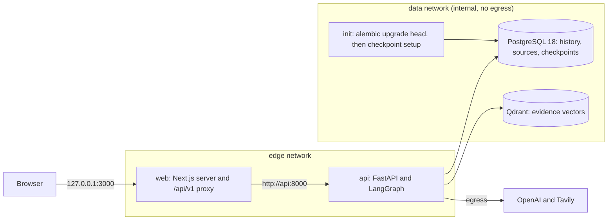

# Nexus Research

**An AI-powered deep research agent.**

Nexus Research answers a research question with a bounded LangGraph workflow. It plans the question, searches the web with Tavily, indexes fetched pages and an optional text PDF into Qdrant, retrieves scoped evidence, and writes a structured report whose citations point at the retrieved passages. A Next.js UI streams progress over server-sent events and keeps a run history.

> **No authentication.** Anyone who can reach the UI can start billable OpenAI and Tavily calls and read every saved run. `research_id` scopes evidence; it is not an access token or tenant isolation. The release stack publishes only Web, on `127.0.0.1`. Do not expose it publicly. For remote access, see [Private remote access](docs/release/deployment.md#private-remote-access).

## Status

**MVP `v0.1.0`.** Phases 1–7 are done. CI builds both images and runs a packaged smoke test with a mocked model. The paid-provider demo and the rest of Gate C are recorded in [`docs/release/checklist.md`](docs/release/checklist.md). Multi-user Alpha (`v0.2.0`) is a separate milestone in the [roadmap](docs/roadmap.md).

## Features in v0.1.0

- **Planning.** `POST /api/v1/research/plan` returns a structured plan from OpenAI (strict JSON schema).
- **Discovery.** Bounded Tavily search through model tool calls, returning only sources that were actually retrieved.
- **Evidence.** Text PDFs (up to 10 MiB and 100 pages) and public HTML pages are chunked, embedded with `text-embedding-3-small` and stored in Qdrant, filtered by `research_id`. Private, loopback and metadata URLs are refused.
- **Research run.** A LangGraph workflow (planning, discovery, ingestion, retrieval, evaluation, synthesis) with caps on iterations, searches, model calls, pages, passages and wall-clock time. Outcomes are `completed`, `partial`, `insufficient_evidence`, `failed` or `interrupted`. PostgreSQL stores checkpoints and the domain history.
- **Web UI.** Ask a question, optionally attach a text PDF, watch stage progress and heartbeats over SSE, stop a run, open saved reports and history, and follow `https` citations or read `PDF · page N` labels. Light and dark themes.
- **Reliability.** JSON logs with an allowlist, optional OpenTelemetry tracing (off by default), partial cost estimates in logs, a failure matrix, and an offline evaluation suite locked to a committed baseline.
- **Release packaging.** Non-root API and Web images built from lockfiles, a private full-stack `compose.release.yml` with one-shot schema initialization, static Compose checks and a packaged smoke script.

## Architecture



Only `web` has a host port. `api` joins both networks. `init` runs once on every `up` and must exit 0 before `api` starts. Provider keys reach only the `api` container; nothing is sent to the browser. Research is request-scoped: there is no worker, queue or automatic resume.

| Layer | Technology |
|---|---|
| API | Python 3.14, FastAPI, Pydantic, SQLAlchemy async, Alembic, uv |
| AI | OpenAI (`gpt-4o-mini`, `text-embedding-3-small`), LangChain, LangGraph, Tavily |
| Storage | PostgreSQL 18.6, Qdrant 1.19.2 |
| Web | Next.js 16 (standalone output), React 19, Node 24 |
| Tooling | pytest, Ruff, mypy, Vitest, Docker Compose, GitHub Actions |

## Prerequisites

- **Release stack:** Docker Engine with the Docker Compose plugin (v2 or later), `openssl`, and `python3` for the static Compose check. Tested on linux/amd64 only. Local Python and Node are not needed.
- **Provider keys:** an OpenAI API key and a Tavily API key for real research. Without them the stack starts and is healthy, and research routes return 503 `provider_not_configured`. Every research run is billed to these accounts.
- **Development:** Python 3.14, uv and Node 24. See [`docs/development.md`](docs/development.md).

## Quickstart (release stack)

From the repository root:

```bash
cp .env.release.example .env.release
chmod 600 .env.release
# Set POSTGRES_PASSWORD (openssl rand -hex 32), NEXUS_OPENAI_API_KEY and NEXUS_TAVILY_API_KEY.
docker compose --env-file .env.release -f compose.release.yml config --quiet
docker compose --env-file .env.release -f compose.release.yml up -d --build
docker compose --env-file .env.release -f compose.release.yml ps
curl -fsS http://127.0.0.1:3000/api/v1/health/ready
```

Readiness returns `{"status":"ok","postgres":"ok","qdrant":"ok"}`. Open `http://127.0.0.1:3000`.

Stop with `docker compose --env-file .env.release -f compose.release.yml down`. That keeps the `nexus-release` volumes; `down -v` deletes them.

Environment variables, schema initialization, upgrades and remote access are in [`docs/release/deployment.md`](docs/release/deployment.md).

## Evaluation

CI runs the offline suite without any API key and fails when its output differs from [`docs/evaluation/baseline.json`](docs/evaluation/baseline.json):

```bash
cd apps/api
uv run python -m nexus.evaluation --suite offline --output /tmp/nexus-eval-offline.json
diff -u ../../docs/evaluation/baseline.json /tmp/nexus-eval-offline.json
```

The scores (Recall@5, Precision@5, MRR@5) are computed over frozen fixture rank lists. They check citation provenance, grounding structure and metric arithmetic. They do not measure live OpenAI embedding or Qdrant retrieval quality, and a valid citation is not proof of entailment. The optional live judge is manual and informational. See [`docs/evaluation/methodology.md`](docs/evaluation/methodology.md) and [`docs/evaluation/failure-matrix.md`](docs/evaluation/failure-matrix.md).

## Documentation

| Document | Contents |
|---|---|
| [`docs/release/deployment.md`](docs/release/deployment.md) | Release setup, startup, schema init, network isolation, secrets, upgrades, shutdown |
| [`docs/release/operations.md`](docs/release/operations.md) | Health, logs, failed init, persistence, backups, rollback, stale runs |
| [`docs/release/demo.md`](docs/release/demo.md) | Mocked CI smoke versus manual paid-provider demo |
| [`docs/release/limitations.md`](docs/release/limitations.md) | Known limitations and production restrictions |
| [`docs/release/checklist.md`](docs/release/checklist.md) | Gate C release checklist |
| [`docs/development.md`](docs/development.md) | Local development, API reference, tests, CI |
| [`docs/roadmap.md`](docs/roadmap.md) | MVP phases and the Alpha milestone |
| [`CHANGELOG.md`](CHANGELOG.md) | Release notes |
| [`docs/adr/`](docs/adr/) | Architecture decisions |

## Purpose

A hands-on AI engineering project focused on Python, agent orchestration, retrieval-augmented generation, tool calling, and production-oriented development practices.
