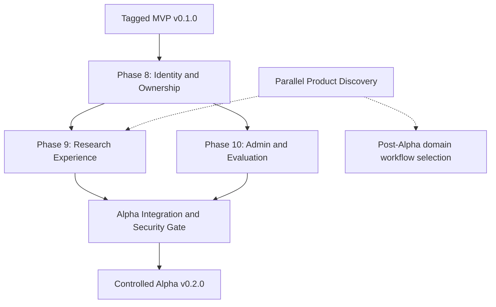

# Alpha v0.2.0 — Product & Engineering Vision

**Project:** Nexus Research  
**Target release:** Alpha `v0.2.0`  
**Status:** Proposed  
**Date:** 2026-10-21  
**Baseline:** [MVP `v0.1.0`](https://github.com/maxdudko/nexus-research/releases/tag/v0.1.0)  
**Roadmap:** [`../roadmap.md`](../../roadmap.md)

## 1. Vision

Evolve Nexus Research from a private, single-operator deep-research MVP into a **controlled, multi-user AI research application** with a usable product experience and operator-facing quality diagnostics.

Preserve the **general-purpose research core** while exploring **Product & Market Intelligence** as the first possible specialized workflow. The market, ideal customer profile, pricing, and product-specific workflows remain hypotheses under parallel product discovery; they are **not** release dependencies for the general platform foundations.

The Alpha has two legitimate outcomes:

1. **Engineering:** a secure, maintainable, independently usable research application, suitable for limited invited-user testing.
2. **Learning:** substantial hands-on Python, FastAPI, asynchronous persistence, security, evaluation, and testing practice, regardless of eventual commercial positioning.

**North star for this milestone:** multiple invited users can independently conduct and revisit research while an authorized operator can inspect the system's quality and operational signals, without weakening evidence isolation or implying unverified research accuracy.

## 2. Starting point — MVP v0.1.0

The tagged MVP includes FastAPI, Pydantic, async SQLAlchemy/Alembic, PostgreSQL, LangGraph research with checkpoints, Tavily/OpenAI, Qdrant evidence scoped by `research_id`, optional text-PDF ingestion, request-scoped SSE with cancellation, persisted research history/reports, a Next.js interface, offline evaluation, opt-in tracing, and a private Docker Compose deployment.

Critical limitations carried into Alpha planning:

- There is **no user identity, authentication, authorization, or per-user data ownership**. Existing run history endpoints are instance-wide; `research_id` is an evidence selector, **not an access control boundary**.
- Qdrant passages, source records, run details/history, SSE, PDF ingestion and retrieval are not protected by a user-level authorization model.
- LangGraph checkpoints are persistent but not resumed automatically. Research remains **request-scoped**; abrupt shutdown can leave a stale `running` record.
- Existing offline evaluation compares frozen fixtures. It does **not** establish live retrieval relevance, factual correctness, or a report-quality guarantee.
- The release stack is loopback-only and not ready for anonymous public hosting. API calls incur operator-funded provider costs.

Alpha builds on this baseline; it should not rewrite or invalidate proven research contracts without a separately reviewed need.

## 3. Design principles

1. **General core, optional specialization.** Planning, discovery, ingestion, retrieval, synthesis and evaluation remain reusable across domains. Product Intelligence is a candidate workflow built on top, not hard-coded into the core.
2. **Authorization at every data boundary.** A valid session alone is insufficient. Every operation must check the relevant resource owner, including indirect IDs, vector retrieval, SSE and report access.
3. **Simple before scalable.** A single-user-owned research model is an acceptable Alpha starting point. Organization/workspace tenancy should be introduced only if the chosen requirements justify it; preserve a path for later expansion.
4. **Human-verifiable evidence.** Retain source provenance and explicit uncertainty. Never equate a valid citation or evaluation score with a guaranteed true statement.
5. **Operational visibility with privacy.** Diagnostics and usage metrics are useful, but user questions, source excerpts, credentials and evaluation cases require careful access and logging policies.
6. **Specification before implementation.** Phase-level SDD (`spec.md`, ADRs, `plan.md`) resolves security contracts and trade-offs before invasive changes. Use Plan → Learn → Implement → Tests → Review where hands-on Python learning is valuable.
7. **Small reviewable increments.** Preserve the existing MVP release tag, use migrations, test regressions and maintain a working research path during the Alpha build.
8. **Market discovery runs independently.** ICP and differentiation findings may alter priorities or UX, but do not block foundational security and general research infrastructure work.

## 4. Alpha pillars

### Phase 8 — Identity & Multi-User

**Objective:** provide authenticated user identity and server-enforced isolation of research data.

**Candidate scope:**

- User entity, restricted onboarding (invitation or explicitly controlled registration), login/logout, durable secure sessions, account settings and a minimal role split (`user` / platform `admin`).
- Explicit ownership of runs, reports, source metadata, evidence and related research operations; secure handling of existing unowned MVP records.
- Authorization enforced in queries and services for history, detail, evidence retrieval, ingestion, PDF upload, synchronous research, SSE and checkpoint/thread access; avoid accepting client-supplied owner IDs as authority.
- Migration and rollback/recovery plan for schema evolution; negative tests for IDOR/BOLA, cross-user evidence leakage, unauthorized streams and administrative endpoints.
- Basic abuse controls appropriate to a controlled invitation-only Alpha: bounded runs, user-aware concurrency/rate/cost controls where required by the release security review.

**Not predetermined:** identity provider or authentication library, session/token format, exact schema ownership model, and whether external organizations are represented. Resolve in Phase 8 specifications/ADR.

**Exit evidence:** two distinct test accounts can run research concurrently and cannot read, search, mutate or infer each other's resources through supported API paths. Migrated MVP data has an explicit safe owner/disposition. AuthN, AuthZ and regression suites pass.

### Phase 9 — Product Experience

**Objective:** make the research application understandable and independently usable by an invited non-developer.

**Candidate scope:**

- Responsive app shell, navigation, dashboard with user-owned recent research and status, clear entry into a research session.
- Improved research creation, input validation, PDF attachment feedback, live stages/heartbeat, cancellation and terminal states.
- Readable report detail with sources/citations, warnings/uncertainty and refreshable history; explicit empty/loading/error states.
- User onboarding, profile/session affordances, accessibility and basic usability tests; keep private deployment limitations visible.

**Not predetermined:** exact layout, design system, a product-specific competitor dashboard, advanced project taxonomy, collaboration, or sharing.

**Exit evidence:** an invited user can sign in, understand what to do, complete or safely interrupt research, revisit only their own report and recover from expected errors without referring to developer instructions.

### Phase 10 — Admin & Evaluation

**Objective:** give a restricted operator reproducible insight into research quality, run health and approximate resource usage.

**Candidate scope:**

- Server-authorized admin routes and UI, isolated from user-facing actions, with explicit data-minimization policy.
- Persisted evaluation metadata/results (dataset, model/prompt versions, configuration, timestamps, outcome) and history with comparability rules.
- View existing offline baseline and live/informational evaluation separately; compare compatible runs, inspect case outcomes and confusion matrices where labeled predictions permit them.
- Basic research run diagnostics, failure categories and usage/cost estimates with coverage/unknowns clearly presented; distinguish estimates from provider invoices.
- Bounded evaluation execution only if separately specified and secured. A read-only evaluation explorer may be sufficient for Alpha.

**Not predetermined:** scheduled/paid evaluation jobs, an unbounded admin task runner, sensitive raw prompt storage, billing, or comprehensive BI analytics.

**Exit evidence:** only an authorized admin can view operational/evaluation data; baseline comparison is reproducible and correctly labeled; normal users cannot enter admin routes or access their data; no bogus claims about live factual accuracy or complete cost coverage.

## 5. Cross-phase contracts and dependencies

- Phase 8 is a **security prerequisite** for exposed authenticated users, user-owned history, and admin access.
- Phases 9 and 10 can be planned in parallel after their API/authorization contracts are agreed, but need not share one delivery gate until integration.
- Maintain source attribution across PostgreSQL and Qdrant, and ensure checkpoint identifiers are never treated as tenant credentials.
- Existing SSE lifecycle and research budgets remain in force unless a dedicated ADR changes them.
- Use a **private/controlled deployment** until a separate public-deployment security review covers abuse, credentials, data privacy, rate limits, operational readiness and cost exposure.

## 6. Alpha scope boundaries

### Core — candidate for v0.2.0

- Authenticated, controlled onboarding and secure session lifecycle.
- Per-user run/report/source/evidence ownership and authorization, including data migration and negative security tests.
- A usable general-purpose research UI: navigation, dashboard, input, progress, results, history, feedback and onboarding.
- Restricted admin access and a reproducible, privacy-aware evaluation history/comparison experience.
- CI/release updates, basic operational diagnostics and controlled Alpha verification.

### Stretch — subject to time and measured need

- Expanded cost/usage dashboard with improved coverage; lightweight export; user-level preferences; richer research organization; additional accessibility/usability polish.

### Out of scope — unless explicitly re-approved

- Organizations, team collaboration, shared workspaces, invites between users, enterprise RBAC/SSO.
- Billing and paid subscriptions, anonymous public SaaS launch, guaranteed multi-tenant production isolation without verification, HA and distributed deployment.
- Durable background research, automatic checkpoint resume, queues, schedulers and continuous competitor monitoring.
- Universal multi-provider/BYOK architecture, multi-agent swarms, extensive connectors, OCR/document library and large-scale RAG redesign.
- A mandatory Product & Market Intelligence-specific workflow, market-fit claims, or automated fact-truth guarantees.

## 7. Alpha release definition of done

1. **Identity and isolation:** authentication and authorization tests, including cross-user negative cases, pass for all supported routes and stores; MVP data migration policy is implemented and verified.
2. **Product usability:** a new invited user can complete the core research journey without engineering help; essential responsive/accessibility and recovery states are exercised.
3. **Admin correctness:** restricted operator views, evaluation provenance and comparable-run diagnostics work; inaccessible to standard accounts.
4. **Reliability:** existing offline baseline remains unchanged unless intentionally versioned; API/Web tests, migrations and packaged smoke are green on the release commit.
5. **Operational safety:** rate/cost exposure is reviewed, secrets are protected, logs are privacy-aware, backups and upgrade paths are documented. Public anonymous deployment is not implied.
6. **Evidence:** manual multi-account end-to-end checks and a limited controlled user pilot are recorded; known limitations and any unresolved risks are explicit.
7. **Release:** reviewed documentation/changelog, release checklist, annotated tag `v0.2.0` and release notes after a GO decision.

A commercial product-market fit result, paid customers or a public SaaS launch are **not** Alpha release requirements. Those remain separate product validation outcomes.

## 8. Engineering and learning track

Alpha is also a deliberate Python engineering lab. Each phase should expose decisions and code worth understanding rather than delegating all implementation to generated code:

- **Phase 8:** FastAPI dependency injection, secure sessions, asyncio boundaries, SQLAlchemy relationships and scoped queries, Alembic migrations, pytest fixtures, authorization property/negative tests.
- **Phase 9:** API contract design, typed Pydantic schemas, SSE semantics, error modeling, integration tests, accessible web UX.
- **Phase 10:** evaluation dataset provenance, statistics/confusion matrices, versioned result models, asynchronous work, safe logging, observability and cost accounting.

Suggested workflow: **Plan → Learn → Implement → Tests → Review → Retrospective**. Require explanations and targeted self-implemented tasks for learning-intensive changes; measure both product behavior and technical understanding.

## 9. Decisions deferred to phase specifications / ADRs

- Authentication provider, credential method, session storage/rotation/revocation, CSRF protection, recovery and enrollment policy.
- User-owned data model vs future workspace ownership, service authorization pattern, PostgreSQL row-level security decision, Qdrant filtering strategy, cross-user checkpoint/thread security.
- Ownership attribution/migration for existing records; backup and rollback strategy, old API compatibility during migration.
- Admin scope and privacy policy; evaluation run persistence and execution boundaries; metric comparability and retention.
- Alpha CI triggers/cache/smoke policy; exposure model and minimum limits for invited user testing.
- Final product ICP and positioning, selected specialized workflow, pricing and go-to-market approach.

## 10. Milestones and next actions

1. Review and accept this vision as an **intent document**, not an implementation specification.
2. Write the Phase 8 `spec.md`, ADR(s) and `plan.md` using the current codebase as evidence; decide authentication and ownership **before schema changes**.
3. Implement Phase 8 with an explicit security review gate, then Phase 9 UX and Phase 10 admin/evaluation in small reviewable increments.
4. Keep product discovery and user interviews in a separate track; revisit specialized workflow priority before locking UX contracts.
5. Prepare the controlled Alpha release checklist and tag `v0.2.0` only after integration evidence.

**Related:** [`../roadmap.md`](../../roadmap.md), [`../release/limitations.md`](../../release/limitations.md), [`../adr/ADR-007.md`](../../adr/ADR-007.md), [`../evaluation/methodology.md`](../../evaluation/methodology.md).
