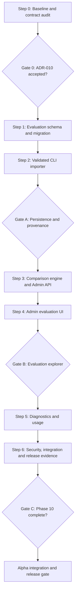

# Phase 10 — Admin & Evaluation Implementation Plan

**Status:** Gate 0 approved 2026-10-24 — Step 1 may start  
**Baseline:** `development` at `9fb4f096606f59f61f47713c8f8f7f0b71e7c4c5`  
**Target:** Nexus Research Alpha `v0.2.0`  
**References:** [spec.md](spec.md), [ADR-010](../../adr/ADR-010.md), [Gate 0](gate-0.md), [Alpha vision](../alpha-v0.2.0-vision.md), [ADR-008](../../adr/ADR-008.md), [ADR-009](../../adr/ADR-009.md), [evaluation methodology](../../evaluation/methodology.md)

## Working agreement

Use **Plan → Learn → Implement → Tests → Review → Retrospective**. Keep changes in small reviewable steps and require evidence before Gate A/B/C. No automatic code generation is assumed to be correct. Preserve Phase 8 owner isolation, Phase 9 authenticated shell, the MVP offline byte-regression gate, and the existing CLI live opt-in safeguards.

Gate 0 is recorded in [gate-0.md](gate-0.md), and ADR-010 is Accepted. Step 1 may start. The operator approved the four high-level choices on 2026-10-24; Gate 0 fixed the detailed contracts.

## Group 0 — Architecture review

### Step 0 — Verify baseline, finalize contracts, accept ADR-010

**Inspect:**

- `apps/api/src/nexus/evaluation/{__main__,runner,schemas,datasets,calibration,retrieval}.py` and `apps/api/tests/evaluation/`.
- `docs/evaluation/{baseline.json,methodology.md,outputs/nexus-eval-live.json}`.
- `apps/api/src/nexus/{models/run.py,research/history.py,observability/usage.py,observability/costs.py,api/deps.py,api/v1/router.py}`.
- `apps/api/alembic/versions/`, `apps/web/src/app/(app)/`, `apps/web/src/lib/{api,proxy}.ts`.
- Phase 8/9 Gate records, ADR-008/009, CI and release smoke.

**Actions:**

1. Verify HEAD/branch and Alembic head; record the commit SHA. Do not assume the 2026-10-24 inspection is still current when implementation begins.
2. Confirm all four approved product choices and the ADR-010 technical details; decide exact table constraints, metric contract version, import CLI flags, and dataset hash algorithm.
3. Build a field-by-field **sensitive data exclusion matrix** for evaluation import, admin DTOs, diagnostics and logs.
4. Define baseline import provenance for old artifacts with missing timestamps/commit; verify offline recomputation and live matrix consistency are feasible with existing fixtures.
5. Agree on endpoint routing (register `/evaluations/compare` before dynamic ID), response error envelope, pagination, date windows and Phase 9 shell integration.
6. Record decisions and test strategy in `gate-0.md`; mark ADR-010 `Accepted` only after review.

Recorded on 2026-10-24. Alembic head `e3b7d91c4a20`. `SCORER_VERSION` is `"1"` and stays out of the CLI artifacts. Import, hash, comparison, privacy, and shell rules are ADR-010 C1–C6.

**Gate 0 exit:** met. Step 1 is authorized. Auth, privacy, migration, provenance, and comparability contracts are recorded.  
**Learning:** evaluation methodology, reproducibility, SQL isolation, data minimization.

## Group A — Evaluation persistence and importer

### Step 1 — SQLAlchemy models and Alembic migration

**Likely files:** `models/evaluation.py`, `models/__init__.py`, new Alembic revision, `admin/schemas.py`, DB model/integration tests.

1. Create `EvaluationRun` and `EvaluationCaseResult` models from spec FR-03; add composite case key, unique artifact SHA, foreign key and descending-history index.
2. Add check constraints for suite/outcome/provenance/category, positive K, hex digests and bounded identifiers; use PostgreSQL JSONB only for allowlisted metrics/config.
3. Create a migration after the **current** head. No changes to `research_runs`, `research_reports`, `research_scopes`, Qdrant or LangGraph checkpoints.
4. Test clean upgrade, upgrade with existing MVP/Alpha data, and downgrade on disposable test DB; preserve backups for real deployments.
5. Add repository read/insert functions with atomic transactions and duplicate-safe handling; no update endpoint or mutable admin API.

**Tests:** constraints, FK/cascade, unique hashes, composite uniqueness, concurrent duplicate insert, migration smoke, no accidental research-data columns.  
**Exit:** schema and repository ready; existing app behavior unchanged.  
**Learning:** SQLAlchemy 2.x typed ORM, async transactions, Alembic, JSONB, PostgreSQL uniqueness.

### Step 2 — Import CLI, provenance, and canonical validation

**Likely files:** `admin/evaluation_import.py`, `admin/evaluation_store.py`, `admin/provenance.py`, `admin/normalization.py`, `admin/comparison.py` (only pure validation helpers), CLI tests.

1. Parse the existing `OfflineReport`/`LiveReport` schemas without modifying the CLI execution path. Reject unknown report versions and oversized/malformed files.
2. Implement canonical dataset fingerprint from the five fixture files; validate dataset version, semantic IDs, case counts and allowed outcome/label combinations.
3. Offline: re-run frozen suite and compare normalized reports; mark `offline_recomputed`. Live: recompute judge counts/calibration and verify aggregate consistency; mark `operator_imported`.
4. Convert reports to **strict sanitized persistence DTOs**: no rationale, claim/question/excerpt text, URLs, source content or raw prompt. Verify with sentinel strings and schema allowlists.
5. Compute artifact hash; insert run and cases atomically; identical reimport returns existing ID, metadata collision rejects, partial failure rolls back.
6. Provide operator instructions to import committed baseline and optional existing live artifact. No import on app startup, no network/provider calls.

**Tests:** offline/live golden files, invalid version, wrong dataset hash, missing/duplicate case, forged counts/matrix, invalid labels, failed import rollback, repeat import, concurrent repeat import, no provider invocation, no sensitive text persistence.  
**Exit:** reproducible import into PostgreSQL with documented provenance limits.  
**Learning:** Pydantic strict validation, hashing, transactional idempotency, trustworthy test data.

### Gate A — Persistence and provenance

Evidence required:

- One offline artifact and one informational live artifact imported; history contains exact case counts and immutable metadata.
- Reimport returns same run ID; invalid import produces zero new rows.
- Committed baseline CI byte comparison still passes.
- Inspect DB rows and prove free-text judge rationale/claims are absent.
- Alembic upgrade/downgrade and API regression tests green.

**Decision:** approve Group B only with recorded evidence.

## Group B — Admin evaluation API and UI

### Step 3 — Pure comparison service and protected read-only API

**Likely files:** `admin/comparison.py`, `admin/evaluation_store.py`, `admin/schemas.py`, `api/v1/admin.py`, `api/v1/router.py`, API tests.

1. Implement strict compatibility predicate and stable reason codes from ADR-010. Use Decimal for signed deltas and preserve null/undefined metrics.
2. Reuse `calibration.py` semantics for live confusion matrix; never produce one for offline results.
3. Add `GET /admin/evaluations`, `/evaluations/compare`, `/evaluations/{id}`, `/evaluations/{id}/cases` with keyset pagination and typed allowlisted DTOs.
4. Attach `require_admin` to all routes; return `Cache-Control: no-store`. Register static compare route before the dynamic ID route.
5. Verify SQL projections avoid report/user/source data and that the API cannot return raw artifact JSON or judge rationale.

**Tests:** anonymous 401, user 403, admin success, revoked session 401, not found 404, route precedence, cursor stability, incompatible comparisons, matching comparisons, Decimal precision, null metrics, matrix orientation/exclusions, no sensitive fields.  
**Exit:** read-only admin evaluation API is secure and semantically correct.  
**Learning:** FastAPI dependencies, DTO boundaries, keyset pagination, metric correctness.

### Step 4 — Evaluation Explorer UI

**Likely files:** `apps/web/src/app/(app)/admin/...`, `components/admin/...`, `lib/admin-api.ts`, relevant tests.

1. Extend the Phase 9 shell with admin-only navigation and `/admin/evaluations` history.
2. Add evaluation detail with suite, dataset fingerprint/version, scorer/report version, code revision/provenance, import/execution timestamps, summary and sanitized case table.
3. Add two-run comparison: explicit compatibility warning/reasons; deltas only when comparable; live confusion matrix with axes and counts.
4. Label all measurements accurately (`Frozen fixture regression`, `Informational live judge`), including sample size and skipped/failed cases.
5. Provide responsive loading/empty/error/forbidden states; keyboard-accessible pagination/tables; avoid raw HTML dashboard embedding.

**Tests:** admin navigation, user hidden navigation plus backend denial, list/detail/compare, compatible/incompatible states, offline matrix absent, live matrix correct, pagination, keyboard and mobile smoke, no persistent private cache.  
**Exit:** operator can import via CLI and inspect results in the browser without changing CLI execution semantics.  
**Learning:** React/Next.js data boundaries, accessible data visualization, state handling.

### Gate B — Evaluation Explorer

Evidence required:

- Browser walkthrough of two compatible offline runs, one incompatible pair, and a live judge run with matrix.
- Cross-role API security matrix green and no private data in API/network response snapshots.
- Exact metric deltas independently verified against canonical stored values.
- Existing evaluation and Web suites green.

**Decision:** approve Group C only with recorded evidence.

## Group C — Diagnostics, usage, and release readiness

### Step 5 — Operational diagnostics and basic usage

**Likely files:** `admin/diagnostics.py`, `admin/usage.py`, `api/v1/admin.py`, admin overview/diagnostics/usage UI, tests.

1. Implement aggregate SQL over `research_runs`: six status counts, error-code distribution, elapsed durations, stale `running` as *last recorded*.
2. Implement safe bounded technical run list only if justified; never return question, report, owner ID/email, research ID, raw trace, URL or source excerpt.
3. Expose the five verified durable `GraphUsage` counters (`iterations`, `search_calls`, `llm_calls`, `pages_indexed`, `pages_failed`) for runs where stored; distinguish logical calls from SDK retries. Return missing usage/cost as `null` and `coverage=unavailable`.
4. If existing persistent validated estimates are available, show pricing version, unknown operations and estimate disclaimer. Do **not** add a new usage ledger or parse logs as billing source.
5. Build Overview, Diagnostics, and Usage views in the Phase 9 shell; add explicit time filters and unknown-coverage explanations.

**Tests:** six-status fixture, empty DB, stale-running, duration null, safe error-code categories, 7/90-day windows, pagination, unknown spend not zero, private fields excluded, role checks.  
**Exit:** basic operational picture without privacy regression or fabricated cost metrics.  
**Learning:** SQL aggregates, observability limits, cost coverage, defensive reporting.

### Step 6 — Security and integration review; docs and release evidence

1. Run API Ruff, mypy, pytest unit/integration, migration tests, evaluation byte-regression, Web lint/typecheck/test/build, and existing release smoke as supported by CI.
2. Test two accounts (`user` and `admin`), anonymous/expired sessions, direct API access, account switching, no-store headers, and Phase 8 cross-user research isolation.
3. Run privacy canary tests: place unique strings in user questions, reports, source excerpts and live judge rationale; assert they never appear in admin API, DB evaluation rows, logs, HTML or browser persistent storage.
4. Review query plans and pagination bounds with realistic sample rows; verify no provider call or Qdrant access on admin page load.
5. Record CLI import demo, compatible/incompatible comparisons, live matrix, stale-running label and missing-cost behavior.
6. Update README/operator docs, `docs/evaluation/methodology.md` (new import workflow only), release limitations, and roadmap status **only after Gate C**. Do not modify `baseline.json` unless a separate reviewed baseline-version change is approved.
7. Document rollback/restore of the new evaluation tables, deployment secrets and known limitations. Phase 10 does not approve public hosting.

**Gate C — Phase 10 exit:** all spec acceptance criteria satisfied, security and privacy review signed off, demos recorded, tests green, no unresolved high-severity issues. Pass evidence to separate Alpha integration/release GO/NO-GO gate.

## Suggested commit / PR boundaries

| Boundary | Contents | Gate |
|---|---|---|
| `phase10/architecture` | Spec, ADR-010, plan, Gate 0 evidence | Gate 0 |
| `phase10/persistence` | Models, migration, repository, tests | Group A |
| `phase10/importer` | CLI import, provenance, sanitized DTOs, tests | Gate A |
| `phase10/evaluation-api` | Comparison service, protected API, tests | Group B |
| `phase10/evaluation-ui` | History/detail/compare UI, tests | Gate B |
| `phase10/diagnostics` | Aggregates, usage, admin views, tests | Group C |
| `phase10/hardening` | Security/privacy, docs, smoke, Gate C evidence | Gate C |

## First implementation slice after Gate 0

Authorized by Gate 0 on 2026-10-24.

**Step 1A:** add only the two SQLAlchemy models, one Alembic revision after `e3b7d91c4a20`, and schema/migration tests. Do **not** touch evaluation CLI, graph execution, Qdrant, LangGraph, user-owned research endpoints, or Next.js UI in this slice. Review the schema diff and migration tests before starting the importer.

## Phase 10 Definition of Done

An admin can browse an immutable history of safely imported evaluation artifacts, compare compatible runs correctly, inspect basic diagnostics and honest usage coverage, and cannot read another user's research content. A standard user cannot access any admin API. Existing offline baseline, research engine, auth/isolation, and CI/release smoke contracts remain intact. Gate C evidence is recorded; `v0.2.0` release requires a separate integration GO decision.
