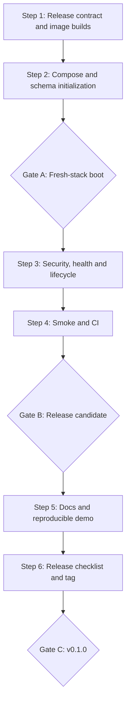

# Phase 7 — Release Implementation Plan

**Target:** `v0.1.0`  
**Status:** Proposed  
**Date:** 2026-10-19  
**References:** `spec.md`, `docs/adr/ADR-007.md`, `docs/roadmap.md`

## Execution model

Use **Plan → Build → Tests → Review** for each step. Make one focused commit per step or tightly related change. Three review gates prevent packaging work from hiding security, startup or documentation defects. Do not introduce Alpha features. No paid provider calls without explicit approval.

### Dependency sequence



## Group A — Packaging & Startup

### Step 1 — Release contract and production images

**Goal:** API and Web images build and run independently from local development toolchains.

**Inspect first:** `apps/api/pyproject.toml`, `apps/api/uv.lock`, `apps/api/src/nexus/main.py`, `apps/web/package.json`, `apps/web/package-lock.json`, `apps/web/next.config.*`, `apps/web/src/lib/proxy.ts`, current Docker-related files, `.gitignore`, README.

**Implementation:**

1. Confirm lockfiles and build paths; decide API `uv sync --frozen --no-dev` packaging and Next.js production output mode based on actual config.
2. Add `apps/api/Dockerfile` with Python 3.14, non-root runtime, installed package, health probe strategy and `uvicorn nexus.main:app` command bound to `0.0.0.0:8000` inside container.
3. Add `apps/web/Dockerfile` with Node 24, `npm ci`, `npm run build`, production server, non-root user and `API_PROXY_TARGET` supplied at runtime. Verify runtime proxy variable is not frozen incorrectly at build time.
4. Add appropriate `.dockerignore` files; exclude local secrets, virtualenv, `node_modules`, `.git`, generated reports.
5. Document chosen image version/digest policy and architecture support. Do not bake credentials or bind-mount source.

**Tests:**

- Build API and Web with clean Docker context, no host Python/Node dependency.
- Run images with safe test config; verify API package import and Web server startup.
- Inspect image contents/history for `.env`, secrets and unwanted source data; assert effective non-root user.
- Verify `API_PROXY_TARGET` can resolve `api` service at runtime.

**Done when:** images build from committed lockfiles, boot with runtime config, contain no secrets, run as non-root.

**Suggested commit:** `build(release): package api and web production images`.

### Step 2 — Release Compose and initialization

**Goal:** a fresh clone can start a complete isolated stack with persistent data and deterministic schema setup.

**Inspect first:** `docker-compose.yml`, `apps/api/.env.example`, `apps/web/.env.example`, `apps/api/alembic`, `apps/api/src/nexus/research/checkpoint.py`, health endpoints, current database URL and Qdrant client config.

**Implementation:**

1. Add standalone `compose.release.yml`; keep existing development Compose behavior unchanged.
2. Define `postgres`, `qdrant`, one-shot `init`, `api`, `web` and optional Jaeger. Use internal DNS `postgres`, `qdrant`, `api`; no cross-container `127.0.0.1`.
3. Publish only Web on `127.0.0.1:3000:3000`; internal API/DB/Qdrant use `expose` or container networking without host `ports`.
4. Use persistent named volumes for PostgreSQL and Qdrant; ensure PostgreSQL 18 mount matches image layout. Configure real release DB credentials without checked-in defaults.
5. Init executes `alembic upgrade head` and `python -m nexus.research.checkpoint` in the correct working directory; verify idempotency. API waits for successful init; Web depends on healthy API where practical.
6. Add release env template and an operator-safe startup command; validate missing secrets before a misleading success state.

**Tests:**

- `docker compose -f compose.release.yml config --quiet` with safe placeholder test variables.
- Fresh volumes: `up --build -d`, verify init exits 0 and API ready.
- Re-run init, restart stack, check migrations/checkpoints still valid and persisted data survives.
- Inspect published ports: only loopback Web, no API/DB/Qdrant host ports.
- Stop Postgres/Qdrant: readiness becomes unavailable; liveness remains available.

**Done when:** full stack boots from fresh volumes with explicit init and survives restart.

**Suggested commit:** `build(release): add private full-stack compose and schema init`.

### Gate A — Fresh-stack boot review

**Required evidence:** actual Compose config, image build logs, init output, health probes, network/port inspection, persistent-volume restart. Block further work if schema init races, the API is host-published, or Web cannot reach API.

## Group B — Hardening & Verification

### Step 3 — Production config, lifecycle and security

**Goal:** packaging does not weaken existing safety boundaries.

**Inspect first:** `apps/api/src/nexus/core/config.py`, `apps/api/src/nexus/main.py`, `apps/api/src/nexus/research/runner.py`, `apps/api/src/nexus/research/streaming.py`, `apps/web/src/lib/proxy.ts`, `apps/web/src/app/api/v1/[...path]/route.ts`, `.env` templates, observability setup.

**Implementation:**

1. Set `NEXUS_ENVIRONMENT=production`; verify docs and OpenAPI are disabled as existing code intends.
2. Ensure provider keys only reach API runtime; none enter Web browser bundles or Docker layers. Confirm log redaction is retained.
3. Verify reverse proxy and Next.js streaming behavior for long-lived SSE, heartbeats, cancellation and unexpected EOF; document upstream timeout greater than graph deadline + grace.
4. Verify graceful signal handling, restart semantics and stale `running` caveat; do not add background resume.
5. Document private-demo access via SSH tunnel/VPN or independently enforced access gate; avoid implying HTTPS alone is authorization.
6. Keep OTel optional and non-fatal. Verify a missing exporter does not change research outcome.

**Tests:** production docs 404, key non-exposure, API/DB private networking, SSE no-buffering and cancellation, controlled shutdown, no hidden provider calls on startup.

**Done when:** no accidental anonymous public endpoint, secret leak or broken streaming behavior.

**Suggested commit:** `test(release): verify private config and runtime lifecycle`.

### Step 4 — Packaged smoke tests and CI

**Goal:** detect release regressions in clean environments.

**Inspect first:** `.github/workflows/ci.yml`, `apps/api/tests`, `apps/web/src/**/*.test.*`, `docs/evaluation/baseline.json`, `docs/evaluation/methodology.md`.

**Implementation:**

1. Add `scripts/release-smoke.sh` or a Python equivalent with bounded retries and cleanup. Script should accept the release Compose file and avoid paid API calls.
2. Validate Compose config, image builds, fresh init, API liveness/readiness, Web route and Next.js API proxy. Use predictable non-sensitive test env and isolated Compose project/volumes.
3. Add a test that confirms only Web has a host port and that it binds loopback.
4. Add image build checks to GitHub Actions; run packaged smoke in CI if reliable or as a mandatory, documented release workflow gate. Upload sanitized logs on failure; avoid exposing secrets.
5. Preserve all existing API/Web gates and offline evaluation byte comparison. Do not change frozen baseline to make a failing test pass.
6. Provide optional manual live demo command, clearly separated from CI.

**Tests/commands:**

```bash
cd apps/api
uv sync --frozen
uv run ruff check .
uv run ruff format --check .
uv run mypy src
uv run pytest
uv run python -m nexus.evaluation --suite offline --output /tmp/nexus-eval-offline.json
diff -u ../../docs/evaluation/baseline.json /tmp/nexus-eval-offline.json

cd ../web
npm ci
npm run lint
npm run typecheck
npm test
npm run build

cd ../..
# Release-specific commands must use the exact Compose file and env setup implemented in Step 2.
docker compose -f compose.release.yml config --quiet
```

**Done when:** packaged stack is verifiably bootable and all existing gates still pass.

**Suggested commit:** `ci(release): build containers and validate packaged smoke`.

### Gate B — Release candidate review

**Required evidence:** green CI, fresh packaged smoke, no published internal ports, non-root images, secret hygiene, SSE behavior, persisted state after restart. Capture limitations and known issues instead of masking them.

## Group C — Documentation & Release

### Step 5 — Documentation, examples and operator guide

**Goal:** another developer can reproduce the demo without undocumented knowledge.

**Files:** `README.md`, `docs/roadmap.md`, `docs/release/deployment.md`, `docs/release/operations.md`, `docs/release/demo.md`, `docs/release/limitations.md`, `CHANGELOG.md`.

**Implementation:**

1. Update README from planned capabilities to verified shipped features and exact quickstart commands.
2. Deployment guide: prerequisites (Docker/Compose), env setup, startup/init, health, access via loopback, shutdown, upgrade, volumes, no-public-exposure warning.
3. Operations guide: logs, readiness/liveness, provider failures, migrations, checkpoint initialization, backups, data retention and rollback constraints.
4. Demo guide: representative web question, optional text-PDF case, expected progress, citations, refresh/history, cancellation and partial/insufficient outcomes. Do not invent successful results; record observed outputs separately.
5. Limitations: no auth/user isolation, no background resume, PDF originals not stored, no OCR, partial cost coverage, offline evaluation limitations, no HA or public SaaS security posture.
6. Changelog and roadmap: Phase 7 complete only after evidence; identify Alpha as next milestone, not part of MVP.

**Tests:** hand a clean checkout and guide to another developer or perform a from-scratch walkthrough without relying on existing local containers; validate all links and commands.

**Done when:** instructions match the actual packaged stack and limitations are prominently documented.

**Suggested commit:** `docs(release): document v0.1.0 quickstart operations and demo`.

### Step 6 — Release candidate, demo evidence and v0.1.0

**Goal:** produce an auditable first release.

**Implementation:**

1. Freeze feature scope; merge reviewed Phase 7 PR into `development` per repository workflow. Verify branch and chosen release commit; do not assume default branch strategy.
2. Run all quality gates on the release commit. Record SHA, image build source, CI links, baseline version, date and known issues.
3. Run a **manual opt-in live demo** using OpenAI/Tavily credentials with approved spend: one web research question, one optional text PDF, progress, terminal report, citation navigation, history reload, cancellation/partial path. Record real outcomes only.
4. Verify clean install and persistent restart one final time. Ensure no public anonymous exposure.
5. Create annotated tag `v0.1.0` on reviewed SHA and publish GitHub release notes **only after maintainer approval**. Never auto-push from planning or CI.
6. Create Alpha backlog/milestone for identity/tenancy, product UX, admin/evaluation and user validation; no implementation in Phase 7.

**Release checklist:**

- [ ] AC-01 clean image builds
- [ ] AC-02 full-stack Compose startup
- [ ] AC-03 migrations + checkpoint setup repeated
- [ ] AC-04 API/Web/proxy/SSE verification
- [ ] AC-05 persistent data across restart
- [ ] AC-06 private port exposure
- [ ] AC-07 no baked/leaked secrets
- [ ] AC-08 CI + offline baseline green
- [ ] AC-09 docs and operator walkthrough
- [ ] AC-10 manual live demo evidence
- [ ] AC-11 reviewed tag and release notes

**Suggested commit:** `chore(release): finalize nexus research v0.1.0` (tag separately after approval).

### Gate C — MVP release decision

**GO:** all ACs met, evidence recorded, no known critical security/boot/data-loss defect.  
**NO-GO:** public anonymous API exposure, missing init, broken SSE, unverified clean startup, leaked secrets, failing offline gate, or unverified release tag.  
**Conditional:** if paid provider demo cannot be performed, publish a packaging candidate but **do not claim a fully demonstrated v0.1.0**.

## Cursor prompts

### Prompt A — Packaging design review (before editing)

```text
You are implementing Nexus Research Phase 7 Release, Group A.
Read docs/specs/phase-7-release/spec.md, docs/adr/ADR-007.md and this plan.md.
Inspect the current development branch, particularly docker-compose.yml, both app lockfiles,
Next.js runtime proxy, checkpoint CLI, Alembic and health endpoints.
Produce a concise file-by-file implementation plan and identify unresolved assumptions:
Docker base image versions, Next.js output mode, checkpoint init idempotency,
Compose env/secrets and service health dependencies.
Preserve request-scoped SSE, no authentication and private-by-default exposure.
Do not edit code until the plan is reviewed.
```

### Prompt B — Build Group A

```text
Implement only approved Phase 7 Group A Steps 1–2.
Add production API/Web Dockerfiles, .dockerignore and standalone compose.release.yml.
Use locked installs, non-root runtime, private API/DB/Qdrant network,
loopback-only Web, explicit one-shot Alembic + checkpoint initialization,
and no default release credentials. Keep current development Compose workflow intact.
Add focused build/startup/idempotency tests and document exact verification commands.
Do not add auth, Redis, workers, public exposure or new app features.
Run relevant tests and report any checks not executed.
```

### Prompt C — Group B reliability gate

```text
Review Phase 7 Group A changes against spec.md acceptance criteria.
Implement only Steps 3–4: production configuration and security checks,
SSE proxy/timeout/shutdown regression coverage, container smoke script,
and CI image build verification. Preserve existing offline evaluation baseline.
Use no paid provider calls or real secrets. Verify only Web is loopback-published.
Show test evidence and remaining release risks.
```

### Prompt D — Documentation and final release review

```text
Complete Phase 7 Steps 5–6 after Group B review.
Update README, roadmap, release deployment/operations/demo/limitations docs and CHANGELOG.
Perform a clean-clone operator walkthrough; report actual CI and manual demo results.
Prepare release notes and a proposed v0.1.0 tag SHA, but do NOT push tags,
publish releases or change branch protections without explicit approval.
Keep Alpha features out of the release PR.
```

## Review template

For each group, provide: changed files; design decisions; tests executed (command + result); CI status; new configuration variables; migration impact; security/network exposure; known limitations; deviations from spec; GO/NO-GO recommendation.
