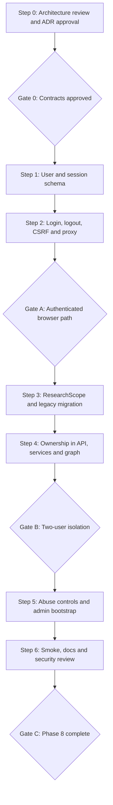

# Phase 8 — Identity & Multi-User Implementation Plan

**Project:** Nexus Research  
**Target:** Alpha `v0.2.0` — Phase 8  
**Status:** Gate 0 approved 2026-10-22 — Step 1 may start; Gates A–C are open  
**Date:** 2026-10-22  
**References:** [`spec.md`](spec.md), [`ADR-008`](../../adr/ADR-008.md), [`gate-0.md`](gate-0.md), [`Alpha vision`](../alpha-v0.2.0-vision.md), [`docs/roadmap.md`](../../roadmap.md)

## Execution model

Use **Plan → Learn → Implement → Tests → Review → Retrospective** for each step. Prefer one focused commit per step. Have the developer implement at least one critical Python unit or integration test in each group before asking Cursor to complete the remainder. Keep all security-relevant decisions traceable to the spec/ADR. No public deployment or paid provider calls as part of automated tests.



## Group 0 — Review before coding

### Step 0 — Approve security and migration contracts

**Inspect first:**

- `docs/specs/alpha-v0.2.0-vision.md`, `docs/roadmap.md`, `docs/release/limitations.md`, ADR-004/005/007.
- `apps/api/src/nexus/models/{run,source}.py`, `research/history.py`, `api/v1/{research,runs,evidence}.py`, `research/{runner,coordinator,graph,checkpoint}.py`, `retrieval/{service,vector_store}.py`, `ingestion/service.py`, `sources/lifecycle.py`.
- `apps/web/src/lib/{proxy,api,research-session}.ts`, `apps/web/src/app/api/v1/[...path]/route.ts`.
- `apps/api/alembic/versions/*`, `apps/api/tests/{unit,integration}`, `.github/workflows/ci.yml`, `compose.release.yml`.

**Actions:**

1. Review `spec.md` and ADR-008; decide local vs managed auth, exact cookie/CSRF/session contract and minimal onboarding UX.
2. Confirm `ResearchScope` ownership and the PDF-first flow: explicit scope creation, then upload, then run.
3. Choose legacy data migration/quarantine strategy; write fresh-install and upgraded-MVP fixtures before altering schemas.
4. Enumerate all billable/private endpoints and provider call paths, including `/plan`, `/discover`, synchronous `/run`, SSE and evidence `/search`.
5. Specify login throttling, per-user research quotas, process count and handling of active streams after revocation.
6. Record decisions, threat model, rollback/recovery procedure and measurable acceptance cases. Change ADR status to Accepted only after review.

**Gate 0 — passed 2026-10-22:** no unresolved security-critical decisions. The API, auth, CSRF, quota, and migration contract is accepted in ADR-008 and recorded in [`gate-0.md`](gate-0.md). No application code changed.

## Group A — Identity & Sessions

### Step 1 — Persistence, account bootstrap and password verification

**Goal:** establish testable identity and session persistence without exposing research routes.

**Implementation:**

1. Add typed ORM models for `User` and `AuthSession`; register them in `nexus.models`; add Alembic migration with uniqueness/index/expiry constraints.
2. Implement normalized login identifiers, Argon2id verification, account disablement and role checks without leaking account existence.
3. Add a CLI for secure initial admin/user provisioning and password reset. No default admin and no plaintext credential logging.
4. Add settings for session lifetime, cookie security and auth throttling. Ensure production validation fails closed on unsafe settings.

**Tests:** password verify/mismatch, normalization, duplicate identity, disabled account, admin bootstrap idempotence, session token hash/verifier, expired session, fresh Alembic upgrade twice, schema constraints.

**Learning focus:** Pydantic validation, async SQLAlchemy, Alembic, Python cryptographic library APIs and pytest fixtures.

### Step 2 — Auth API, FastAPI principal and Next.js proxy

**Goal:** make browser-to-API identity correct before touching research ownership.

**Implementation:**

1. Add `POST /auth/login`, `POST /auth/logout`, `GET /auth/me`; central `get_current_user` and `require_admin` dependencies.
2. Implement cookie issuance/clear, server-side session lookup, expiry/revocation, no-store responses and consistent auth errors.
3. Implement the reviewed CSRF/origin strategy for unsafe methods, including multipart and POST SSE.
4. Update Next.js proxy to forward only intended session/CSRF headers and propagate safe `Set-Cookie`; preserve streaming/abort behavior.
5. Provide a minimal authentication test UI or documented browser path. Full navigation redesign belongs to Phase 9.

**Tests:** login/logout, incorrect credentials, expired/revoked session, CSRF rejection, `Set-Cookie` flags, cookie stripping, no cross-origin leakage, POST SSE and PDF forwarding, `me` after logout, no authenticated response caching.

**Gate A — Authenticated browser path:** login → `me` → logout works through Next.js; invalid sessions and CSRF fail; proxy SSE behavior remains intact. Research routes may still be private/blocked while ownership is implemented. **Do not invite users at this stage.**

## Group B — Research Ownership & Isolation

### Step 3 — ResearchScope, migration and legacy adoption

**Goal:** create an authoritative ownership boundary while preserving existing research IDs.

**Implementation:**

1. Add `ResearchScope(research_id, owner_user_id)` and necessary foreign keys/indexes. Prefer joins for report ownership rather than independent, conflicting `user_id` fields.
2. Migrate distinct legacy research IDs from both `research_runs` and `sources`; preserve existing reports and Qdrant point identifiers.
3. Implement the approved quarantine mechanism and explicit audited operator adoption CLI. No implicit transfer on first login.
4. Add scope repository/service for server-generated scopes and owned-scope lookup. Implement `POST /research/scopes` to support PDF-first research.
5. Add a safe deployment/backup/upgrade procedure. Ensure no application request silently creates missing ownership for a caller-supplied ID.

**Tests:** fresh install, upgrade from seeded MVP dataset, no orphaned scopes, FK integrity, legacy quarantine, explicit adoption, repeated migration/setup, source deduplication and no Qdrant reindex when unnecessary.

**Learning focus:** relational modeling, indexes, FK constraints, migrations, transactional consistency and race conditions.

### Step 4 — Enforce ownership at every research boundary

**Goal:** no authenticated user can access another user's research via API, graph or evidence operations.

**Implementation:**

1. Add `CurrentUser` dependencies to `/plan`, `/discover`, `/run`, `/stream`, history, PDF/web ingestion and evidence search. Require auth before provider calls.
2. Authorize existing research IDs and create new scopes server-side. Unknown/foreign IDs return uniform `404` with no side effects.
3. Refactor `ResearchHistory.list_runs()` and `get_run()` to query through owner-scoped SQL, preserving pagination semantics.
4. Guard ingestion, source claims, accepted-version lookup and retrieval before embedding or Qdrant access; graph runtime receives an already-authorized scope.
5. Keep checkpoints internal. For any diagnostic thread access, authorize the parent run first. Do not infer owner from UUID or checkpoint payload.
6. Preserve synchronous `/run` and SSE cancellation/heartbeat behavior; prevent unauthorized requests from allocating permits or creating history.
7. Update Web research flow to create a scope before PDF upload and use authenticated requests.

**Tests:**

- Anonymous access to **every** billable/private route produces `401` and zero external side effects.
- User A cannot access B's scope through run, stream, upload, web ingestion, search, history, detail, report or checkpoint diagnostics.
- Concurrent A/B requests, repeated IDs, revoked sessions, cursor manipulation, scope creation races and error responses do not leak data.
- Own-scope research, source deduplication, PDF ingestion, Qdrant accepted-version retrieval, report citations, SSE cancellation and existing offline evaluation still work.

**Gate B — Two-user isolation:** run real Postgres/Qdrant integration tests with accounts A and B, including negative IDOR/BOLA and request concurrency. No direct or indirect evidence leakage. **Do not mark Gate B complete based only on unit tests or UUID unpredictability.**

## Group C — Hardening & Phase 8 Exit

### Step 5 — Admin bootstrap, throttling and resource exposure

**Goal:** safely support limited invited accounts with operator-funded provider usage.

**Implementation:**

1. Complete operator account disable/reset and explicit admin checks; admin does not automatically read others' research.
2. Implement and test bounded login attempts, user-aware research concurrency/rate budgets and limits for `/plan`, `/discover`, `/run`, `/stream`, `/evidence/web`, `/evidence/pdf` and `/evidence/search`.
3. Define stream revocation policy and verify behavior; if active streams cannot be immediately terminated, document the bounded residual risk and require security sign-off.
4. Review logs/traces/error payloads for session tokens, passwords, questions, PDF content and cross-user identifiers. Keep production deployment private.

**Tests:** brute-force throttling, quota exhaustion and recovery, simultaneous user runs, admin 403, session revocation, safe logs and failure behavior. Use deterministic stub providers.

### Step 6 — CI, packaged smoke, documentation and review

**Goal:** verify the entire authenticated multi-user flow in the release-shaped environment.

**Implementation:**

1. Adapt packaged smoke and any demo scripts to bootstrap/login a test account; anonymous research smoke must now fail with `401`.
2. Keep existing fast CI lane on development and full integration/image/smoke lane on PR/master. Add mandatory ownership and session tests to the full lane.
3. Run clean-install and upgrade-from-`v0.1.0` exercises with backup and recovery evidence; verify checkpoint setup remains separate from Alembic.
4. Document account bootstrap, invitation procedure, secrets, HTTPS/cookie constraints, quotas, session expiry, data ownership, migration/adoption, security limitations and operator recovery.
5. Complete a manual two-account demo: login, PDF upload, web research, SSE cancel, history/report, forbidden cross-user access and logout.
6. Perform focused security review and record residual risks. Update roadmap phase status only after Gate C.

**Gate C — Phase 8 complete:** all Phase 8 Definition of Done items pass; CI and packaged smoke are green; legacy upgrade is verified; security review and private two-user demo are recorded. Phase 8 completion **does not** tag `v0.2.0` or authorize public deployment; Phases 9–10 and the Alpha release gate remain.

## Recommended review checklist

- [x] ADR-008 accepted; exact auth, CSRF, ownership and migration contracts recorded (Gate 0, 2026-10-22).
- [x] No anonymous billable API access; no credential or cookie leaks.
- [x] Session expiry/revocation, disabled users, CSRF and admin role tested.
- [x] PostgreSQL queries are owner-filtered before pagination and report loading.
- [x] Qdrant access always follows owned-scope validation; accepted-digest behavior preserved.
- [x] No public checkpoint/thread access or unsafe client-supplied scope creation.
- [x] Legacy records quarantined/adopted explicitly without loss.
- [x] Two-user integration and negative security matrix pass.
- [x] Existing SSE, research and offline evaluation regressions pass.
- [x] Cost/usage bounds and private deployment limitations documented.

## Suggested local commands

From `apps/api/`:

```bash
uv sync --frozen
uv run ruff check .
uv run ruff format --check .
uv run mypy src
uv run pytest -m "not integration and not live"
```

For integration tests, start the development PostgreSQL/Qdrant services using the repository's documented Compose commands, then run:

```bash
uv run pytest -m "integration and not live"
uv run alembic upgrade head
uv run alembic upgrade head
```

From `apps/web/`:

```bash
npm ci
npm run lint
npm run typecheck
npm test
```

Run the existing packaged smoke through CI/its documented script after updating it for authentication. No live provider calls without explicit operator approval.

## Suggested first implementation task after Gate 0

**Step 1A:** add `User` + `AuthSession` ORM models, a migration and targeted tests **only**. Do not touch the research graph, Qdrant or UI in that commit. Ask Cursor to explain every constraint, index and security assumption before implementing the next step.
