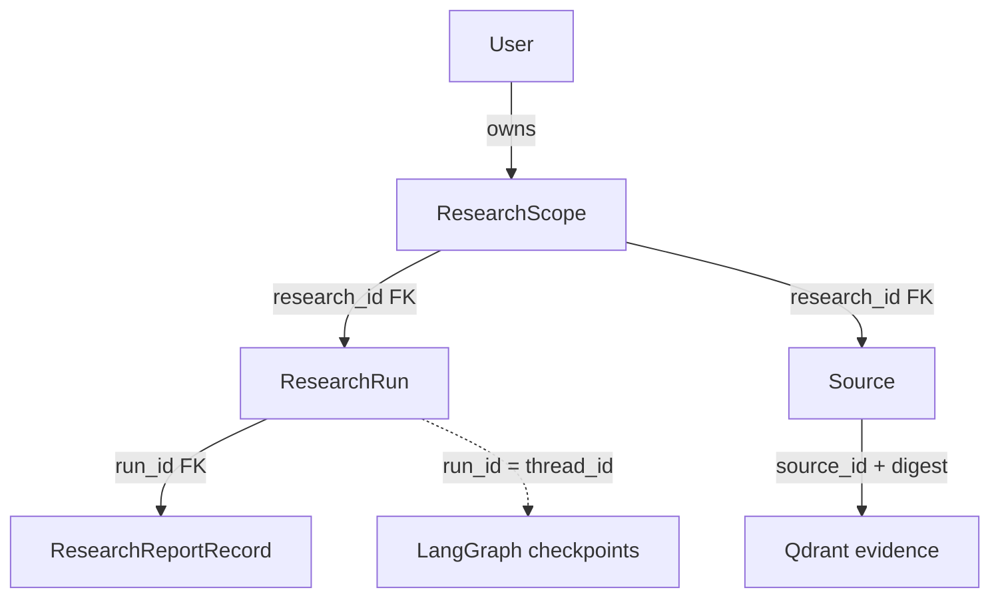

# Phase 8 — Identity & Multi-User Specification

**Project:** Nexus Research  
**Target:** Alpha `v0.2.0` — Phase 8  
**Status:** Proposed — requires architecture/security review before implementation  
**Date:** 2026-10-22  
**Baseline:** `development` at `7f25fa0e07c1705d6ad77da23f984df80dd3721b`  
**Related:** [`docs/specs/alpha-v0.2.0-vision.md`](../alpha-v0.2.0-vision.md), [`docs/roadmap.md`](../../roadmap.md), [`ADR-008`](../../adr/ADR-008.md), [`plan.md`](plan.md)

## 1. Objective

Turn the private, anonymous, single-operator MVP into a **controlled, authenticated multi-user research service**. Multiple invited users must be able to create and revisit research independently without reading, modifying, indexing into, or searching one another's data. Preserve the general-purpose research graph, source provenance, request-scoped execution and existing evaluation behavior.

**Phase 8 is a security foundation, not a public SaaS launch.** Passing this phase is necessary but not sufficient for public Internet exposure. Phase 9 owns the redesigned product experience; Phase 10 owns administrative evaluation UI.

## 2. Verified implementation baseline

As inspected on `development`:

- `apps/api/src/nexus/models/run.py`: `ResearchRun` has `run_id`, `research_id` and status; `ResearchReportRecord` refers to `run_id`. No user ownership.
- `apps/api/src/nexus/models/source.py`: `Source` identity and deduplication are scoped to `research_id`, not to a user.
- `apps/api/src/nexus/research/history.py`: `list_runs()` is instance-wide; `get_run()` loads a run by ID without ownership filtering.
- `apps/api/src/nexus/api/v1/research.py`: `/plan`, `/discover`, `/run` and `/stream` have no principal dependency. The caller may supply a `research_id`; `/stream` creates a domain history row. The synchronous `/run` does not use the same persisted-history path.
- `apps/api/src/nexus/api/v1/evidence.py`: `/pdf`, `/web` and `/search` accept client-provided research IDs and do not authorize their use.
- `apps/api/src/nexus/retrieval/service.py`: PostgreSQL source versions and Qdrant results are filtered by `research_id`; that is **evidence scoping, not authorization**.
- `apps/api/src/nexus/research/graph.py`: LangGraph `thread_id` is `run_id`; checkpoint storage is separate from Alembic domain tables. No public checkpoint-read endpoint currently exists.
- `apps/web/src/lib/proxy.ts`: the Next.js proxy forwards `content-type` and `accept`, but not cookies, CSRF headers or upstream `Set-Cookie`.
- `apps/api/src/nexus/core/config.py`: no auth/session settings. `NEXUS_STREAM_MAX_CONCURRENT` is a process-level bound, not a per-user budget.
- `docs/release/limitations.md`: the MVP is explicitly unauthenticated and loopback/private-only.

Existing tests and offline evaluation are regression constraints; do not silently alter research result or citation semantics.

## 3. Users, roles and trust boundaries

- **Invited user:** authenticates, manages own session and accesses only research scopes they own.
- **Platform administrator:** authenticated user with `admin` role. May bootstrap accounts and access expressly authorized operational functions. **Admin role must not implicitly bypass ownership checks on ordinary research endpoints.**
- **Anonymous visitor:** may reach minimal liveness/readiness where operationally appropriate and auth endpoints, but no billable or private research operation.
- **System/legacy identity:** if adopted by ADR-008 migration design, a permanently non-loginable placeholder for quarantined pre-Alpha records, not a human account.

**Trust boundaries:** browser → Next.js same-origin proxy → FastAPI principal → SQLAlchemy/PostgreSQL → research services → Qdrant/checkpointer/external providers. All IDs from requests, including UUIDs, are untrusted selectors.

## 4. Functional requirements

### FR-01 — Controlled enrollment and identity

1. A `User` has stable UUID identity, unique normalized email, role (`user` or `admin`), account status and timestamps.
2. New accounts are provisioned by an operator-only bootstrap/invitation path. No public self-registration for Phase 8.
3. Credentials are never stored or logged in plaintext; password hashing and reset mechanism follow the approved ADR. No default admin password or hardcoded credentials.
4. A disabled account cannot authenticate or use previously issued sessions.
5. Password recovery may be an audited operator CLI workflow; email delivery and self-service reset are not required.

### FR-02 — Authentication and session lifecycle

1. Implement login, logout, `GET /api/v1/auth/me`, and explicit session expiration/revocation. Auth failure returns a consistent `401` without disclosing whether an account exists.
2. Prefer a server-side revocable, opaque browser session rather than putting authorization claims in a client-controlled token. The final mechanism must be accepted in ADR-008.
3. Session cookies must be `HttpOnly`, `SameSite` and `Secure` in HTTPS environments, with a documented loopback-development exception. Set explicit cookie scope/path, expiry and safe caching headers.
4. Unsafe cookie-authenticated requests require CSRF defenses; authentication must work for multipart PDF upload and long-lived POST SSE without buffering.
5. The Next.js proxy must pass only the necessary auth/CSRF request headers and upstream session cookies safely; it must not expose provider keys, upstream internal URLs or session secrets to client JS.
6. Session revocation, password reset and user disablement take effect on subsequent requests. No silent perpetual sessions.

### FR-03 — Explicit research ownership

1. Introduce a first-class, globally unique **research scope** with one owner (`user_id`). This is a proposed design subject to ADR approval.
2. `ResearchRun` and `Source` must resolve to a valid research scope. Reports inherit access through their run; Qdrant evidence is reachable only after PostgreSQL-backed scope authorization.
3. The server creates new research IDs. A supplied existing ID is accepted only if owned by the authenticated principal; unknown and foreign IDs must not create an implicit scope or disclose existence.
4. Provide an explicit way to create a scope before PDF upload, since the current UI creates a client-side research ID before the run. Proposed route: `POST /api/v1/research/scopes` returning a server-generated ID.
5. The same owner may reuse a research scope for later runs and additional evidence, preserving current research-level deduplication and retrieval semantics.
6. No user-provided `user_id` or role is authoritative. User ownership cannot be changed through ordinary research APIs.

### FR-04 — Authorization across all API routes

1. All billable or private routes require an authenticated principal: `/research/plan`, `/research/discover`, `/research/run`, `/research/stream`, `/research/runs`, `/research/runs/{run_id}`, `/evidence/pdf`, `/evidence/web`, `/evidence/search`, plus any new routes.
2. `GET /research/runs` filters by owner **inside the SQL query before sorting/pagination**, not after loading rows. Detail reads must join/check ownership before returning a report.
3. Source claim, indexing, version lookup, retrieval and Qdrant operations must be reachable only through an authorized scope. Internal graph tools use a scope already bound to the initiating principal, not a raw client ID.
4. Return `401` for unauthenticated access; return a uniform `404` for nonexistent or foreign research/run IDs to avoid resource enumeration. Use `403` for authenticated role-based denials where existence is not sensitive.
5. Do not add public checkpoint/thread read or resume APIs. If future diagnostics read checkpoints, first authorize the related run in domain storage.
6. Authorization must be testable as an explicit service/dependency contract, not copied ad hoc into handlers.

### FR-05 — Research lifecycle and SSE

1. Authenticate and authorize before any provider call, PDF extraction, embedding, Qdrant access or SSE stream creation.
2. Preserve request-scoped cancellation, heartbeats, timeout, final status and current concurrency behavior unless explicitly changed.
3. An unauthorized request must not allocate a stream permit or create a history row.
4. A revoked/disabled session must block new requests; define and test policy for a session revoked **during** an active stream. Minimum safe Alpha policy: terminate the stream on explicit user disable/revocation where practical, and document any residual window.
5. Preserve existing synchronous `/run` behavior unless a separate decision explicitly adds history persistence. Both `/run` and `/stream` require ownership enforcement.

### FR-06 — MVP data migration

1. Do not silently assign existing unowned records to the first person who signs in.
2. Preserve all existing `research_id` groupings across `research_runs` and `sources`; a report continues to inherit its run's access. Existing Qdrant point payloads should remain valid if possible.
3. Default recommendation: backfill pre-Alpha scopes to a **non-loginable legacy quarantine identity**, then provide an explicit, audited operator CLI for adopting those scopes into a chosen real account. Final policy requires ADR approval.
4. Fresh installation and upgrade from an actual `v0.1.0` dataset must be supported and tested. Alembic owns domain schema; LangGraph checkpoint setup remains separate.
5. Never delete pre-Alpha research, checkpoints or Qdrant evidence as an automatic side effect of enabling identity. Define backup, failure and recovery procedures; do not promise an automatic downgrade across irreversible ownership migration.

### FR-07 — Minimal administration and abuse controls

1. Provide an explicit, least-privilege way to create/disable users, reset credentials and bootstrap exactly the intended administrator; an operator CLI is acceptable.
2. Do not implement Phase 10's evaluation dashboard here. Reserve a server-side `require_admin` authorization contract and tests.
3. Protect login against brute force/account enumeration, and protect **all** billable routes against uncontrolled usage. The final rate/concurrency strategy must match the actual number of API workers and private deployment model.
4. Retain current graph/provider budgets. Record safe per-user usage signals without logging prompts, passwords, tokens, PDF content or source excerpts by default.
5. Do not claim public production readiness until a separate exposure, privacy and cost review is passed.

## 5. Proposed API contract

| Route | Auth | Ownership / purpose |
|---|---|---|
| `POST /api/v1/auth/login` | Anonymous | Issue secure session; throttled |
| `POST /api/v1/auth/logout` | Authenticated | Revoke current session; CSRF protected |
| `GET /api/v1/auth/me` | Authenticated | Return minimal current-user identity |
| `POST /api/v1/research/scopes` | Authenticated | Mint a scope owned by current user |
| `POST /api/v1/research/plan` | Authenticated | Billable, quota protected |
| `POST /api/v1/research/discover` | Authenticated | Billable, quota protected |
| `POST /api/v1/research/run` | Authenticated | New/owned scope only; billable |
| `POST /api/v1/research/stream` | Authenticated | New/owned scope only; SSE and quota |
| `GET /api/v1/research/runs` | Authenticated | Owner-filtered history |
| `GET /api/v1/research/runs/{run_id}` | Authenticated | Owner-filtered detail/report |
| `POST /api/v1/evidence/pdf` | Authenticated | Owned existing scope; multipart + CSRF |
| `POST /api/v1/evidence/web` | Authenticated | Owned existing scope; billable |
| `POST /api/v1/evidence/search` | Authenticated | Owned existing scope; billable embedding |
| `GET /api/v1/health/live` | Anonymous/internal | Minimal health response; no private data |
| `GET /api/v1/health/ready` | Operational | Review exposure separately |

**Compatibility:** existing `/research/run` and `/research/stream` request schemas may retain optional `research_id`, but its semantics become owner-validated. New client flow creates a scope before uploading PDF. Final auth route naming and session details are subject to ADR.

## 6. Proposed persistence model

- `users`: UUID, normalized unique email (except internal legacy identity if approved), role, status, password verifier and audit timestamps.
- `auth_sessions`: random-token verifier/hash, user FK, created/last-used/expiry/revocation timestamps. Never persist raw session token.
- `research_scopes`: UUID `research_id` PK, owner `user_id` FK, created/updated timestamps; indexes for owner queries.
- `research_runs.research_id` and `sources.research_id`: foreign keys to `research_scopes.research_id`; indexes support owner-scoped listing and existing source identity.
- `research_reports`: access through run FK; no separate user claim needed.
- Qdrant: existing `research_id` and accepted-digest filter remain; no direct client access. Authorization is resolved in PostgreSQL **before** retrieval/upsert. Optional owner payload is defense in depth, not the primary authority.
- LangGraph: thread ID remains run ID; direct checkpoint operations remain internal and never infer ownership from a UUID alone.

**Invariant:** a research scope has exactly one effective owner; no supported route or internal service may use an unverified scope for private data operations.

## 7. Security and privacy acceptance matrix

| Scenario | Expected behavior |
|---|---|
| Anonymous `/plan`, `/discover`, `/run`, `/stream`, evidence, history | `401`, zero provider calls, no rows/points created |
| User A supplies User B's `research_id` to `/run` or `/stream` | `404`, no side effects, no cost |
| User A uploads PDF or searches User B's scope | `404`, no extraction/embedding/Qdrant access |
| User A requests User B's `run_id` | `404`, report not read/serialized |
| User A lists history with arbitrary cursor | Only A's rows; stable keyset pagination |
| Invalid/expired/revoked session | `401`; no stale authorization |
| Disabled user | Cannot log in; subsequent requests denied |
| Missing/invalid CSRF on unsafe cookie-authenticated request | Rejected before state change |
| Normal user calls admin-only action | `403`, no privileged side effect |
| Concurrent users reuse same requested scope ID | Only the owner succeeds; no scope takeover |
| Pre-Alpha unowned data after migration | Inaccessible until explicit authorized adoption |
| Proxy forwards cookies or SSE | Correct cookie flags, CSRF, unbuffered streaming, no secret leakage |
| Database/Qdrant failure | Existing bounded failure behavior; no cross-user fallback |

Include unit, integration, browser/proxy, migration, and at least one two-account end-to-end negative test. Add regression tests for repeated schema initialization, source deduplication, stream cancellation, report history and checkpoint compatibility.

## 8. Nonfunctional requirements and constraints

- Keep FastAPI handlers thin and typed; use explicit `CurrentUser`/principal dependency and service-layer ownership checks.
- Preserve `uv`, Python 3.14, async SQLAlchemy, Alembic, Next.js and current Compose patterns unless justified separately.
- Do not hold database transactions open during provider calls or graph execution.
- Prefer secure, deterministic behavior under concurrent requests; avoid TOCTOU ownership bypasses and cross-user cache keys.
- Keep credentials/session material out of logs, traces, exception bodies, client bundles and Docker image layers.
- Maintain existing CI fast/full separation. Add auth/isolation tests to full PR integration gates and adapt packaged smoke to use an authenticated test account.
- Preserve `v0.1.0` as an immutable release. The development branch may evolve API behavior under the Alpha milestone.

## 9. Out of scope

Public registration, OAuth/social login, enterprise SSO, organization/workspace sharing, fine-grained enterprise RBAC, user billing, subscription management, email service, durable background workers, scheduled research, automatic checkpoint resume, generic provider/BYOK redesign, domain-specific Product & Market Intelligence features, full Phase 9 UI redesign and Phase 10 evaluation dashboards.

## 10. Phase 8 Definition of Done

1. At least two independently authenticated invited users can execute web research and PDF ingestion, retrieve only their own history/reports/evidence, and use the existing SSE lifecycle.
2. All private/billable endpoints reject anonymous access before doing work; all scope/run IDs are owner-checked; negative IDOR/BOLA tests pass.
3. Login/logout/session expiry/revocation/CSRF behavior is demonstrated through the Next.js proxy, including PDF and SSE.
4. A real `v0.1.0`-style dataset upgrades without data loss or accidental ownership; quarantined legacy data has a documented explicit adoption process.
5. Admin bootstrap and account disablement work; normal users cannot perform administrative operations.
6. Security, unit, integration, regression, migration and packaged smoke tests pass; no live paid provider calls are required in CI.
7. A private two-user demo and focused security review are recorded; documentation states remaining public-deployment limitations.

## 11. Open decisions to resolve before Build

1. Accept or reject ADR-008's proposed local Argon2id + opaque PostgreSQL session approach versus managed identity.
2. Accept the `ResearchScope` ownership model and explicit `POST /research/scopes` API, or document a safer alternative.
3. Approve the legacy quarantine/adoption migration and operator bootstrap workflow.
4. Specify session expiry, cookie names/path, CSRF mechanism and proxy forwarding semantics for dev and private release environments.
5. Specify rate/concurrency enforcement for all billable endpoints and the actual API process topology.
6. Decide what happens to an active SSE stream when its user/session is disabled or revoked.
7. Confirm whether Phase 8 includes minimal login UI or only API/proxy functionality; Phase 9 owns the redesigned experience, but Phase 8 needs a usable authentication test path.

**No implementation should start until decisions 1–5 are explicitly reviewed.**
