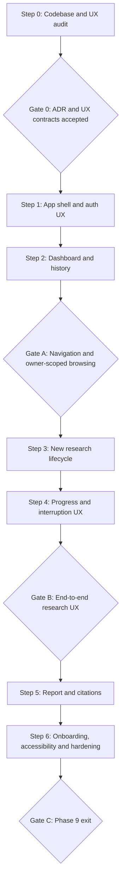

# Phase 9 — Product Experience Implementation Plan

**Project:** Nexus Research  
**Target:** Alpha `v0.2.0` — Phase 9  
**Status:** Gate 0 approved 2026-10-23 — Step 1 may start  
**Date:** 2026-10-23  
**Baseline:** `development` at `53aa78a207a06e0ac570e16aa011b51e92f1e443`  
**References:** [spec.md](spec.md), [ADR-009](../../adr/ADR-009.md), [Gate 0](gate-0.md), [Alpha vision](../alpha-v0.2.0-vision.md), [roadmap](../../roadmap.md), [ADR-008](../../adr/ADR-008.md)

## Execution model

Use **Plan → Learn → Implement → Tests → Review → Retrospective**. Prefer small commits/PRs per workstream, keep the existing research path usable, and do not weaken Phase 8 security or Phase 5 streaming semantics. Gate approvals require evidence, not a status label alone.

## Working rules

1. Inspect existing code and tests before editing; filenames below are targets, not assertions that new files already exist.
2. Keep backend `/auth/*`, `/research/scopes`, `/research/stream`, `/research/runs`, `/evidence/pdf` contracts unchanged unless Gate 0 approves a narrowly justified amendment.
3. Do not introduce background workers, stream reattachment, durable PDF storage, project folders, public registration, billing, evaluation dashboards or a second auth system.
4. Use fake SSE/API responses in default CI; no paid OpenAI/Tavily calls as part of automated UI tests.
5. Preserve `ResearchScope` ownership, same-origin cookies, signed CSRF and the proxy allowlist; do not put session tokens in browser storage.
6. Separate source-of-truth persisted run status from client-only stream status. Do not show fake progress percentages or automatic resume.
7. Before each gate, run relevant Web lint/typecheck/test/build plus API and packaged smoke as required by the existing CI policy. Review diffs for private-data leakage.
8. Update Phase 8 roadmap status separately from Phase 9 only if its recorded Gate C evidence warrants it; avoid unrelated roadmap edits.

## Group 0 — Architecture and UX review

### Step 0 — Verify baseline, accept ADR-009 and establish UX contracts

**Inspect first:**

- `apps/web/src/app/{layout,page,login/page,research/[runId]/page}.tsx`.
- `apps/web/src/components/{auth,research,theme-toggle}/*`.
- `apps/web/src/hooks/use-research-stream.ts`.
- `apps/web/src/lib/{api,types,research-session,sse,report,csrf,proxy,errors,theme}.ts`.
- `apps/web/src/app/globals.css`, `apps/web/package.json`, `apps/web/src/**/*.test.ts*`.
- `apps/api/src/nexus/api/v1/{auth,research,runs,evidence}.py`, `apps/api/src/nexus/schemas/{history,report}.py`.
- `docs/adr/{ADR-005,ADR-008}.md`, `docs/specs/phase-8-identity/gate-c.md`, `.github/workflows/ci.yml`.

**Actions:**

1. Draw the existing browser route and state flow: login → form → scope mint → optional PDF → SSE → detail → history.
2. Inventory the current UX and API states; verify the `running` vs `stalled` vs `disconnected` distinctions and how a route change aborts an active request.
3. Confirm proposed routes (`/`, `/research/new`, `/history`, `/research/[runId]`) and authenticated shell ownership; decide responsive navigation pattern.
4. Decide lazy scope mint lifecycle, failure/retry behavior and explicit user messaging on leaving an active stream.
5. Confirm report/evidence citation rendering and PDF limitations; verify that no missing backend capability is assumed.
6. Record screenshots of current desktop/mobile UI, a component reuse map, the route/state matrix, security regression checklist and any unresolved questions.
7. Review and **accept or amend** `spec.md` and `ADR-009` before implementation.

**Gate 0 — passed 2026-10-23:** ADR-009 is accepted, including clarifications C1–C8. The route/state matrix, API compatibility notes, and security checklist are in [`gate-0.md`](gate-0.md). No API, auth, or SSE contradiction remains open. No application code changed. Step 1 may start.

**Learning focus:** Next.js App Router layout boundaries, React effect cleanup, SSE lifecycle, browser navigation constraints, API contract modeling.

## Group A — App Shell & Dashboard

### Step 1 — Authenticated shell, navigation and session UX

**Goal:** establish a consistent product frame without changing authorization behavior.

**Likely changes:** `apps/web/src/app/layout.tsx`, new authenticated route group/layout, reusable navigation/account components, `auth-gate.tsx`, `login-form.tsx`, theme toggle placement, shell tests.

**Implementation:**

Follow ADR-009 C2, C3, and C7 for the shell, logout, and header.

1. Move common navigation and account identity/logout into a shared authenticated layout; keep `/login` outside it.
2. Display loading, unavailable and session-expired states while resolving `/auth/me`; avoid the current blank-gate failure mode.
3. Keep `401` redirect behavior consistent for deep links; prevent redirect loops and avoid rendering private content before identity resolution.
4. Add visible Dashboard, New research and History navigation; preserve direct links to `/research/[runId]`.
5. Keep theme behavior intact and use semantic `header`, `nav`, `main` landmarks.
6. Ensure logout only reports success after the server accepts revocation; on success discard private in-memory state and redirect to login.
7. Avoid adding a user-settings backend or new auth framework.

**Tests:** anonymous redirect, auth loading/unavailable, valid `me`, logout success/failure, account switch no stale data, keyboard nav, theme persistence, mobile menu open/close/focus.

**Exit:** the authenticated shell works for all private routes and is navigable at mobile and desktop widths.

### Step 2 — Dashboard and dedicated history

**Goal:** provide a useful landing screen and predictable access to persisted research.

**Likely changes:** `apps/web/src/app/page.tsx`, new `apps/web/src/app/history/page.tsx`, reusable run list/card and status components, `research-history.tsx`, `lib/api.ts` only if needed.

**Implementation:**

1. Replace `/` form-centric content with welcome/CTA, recent owner-scoped runs and clear empty/loading/error states.
2. Create `/history` with existing keyset/cursor pagination, stable ordering and deduplication; preserve previously loaded pages when older-page fetch fails.
3. Reuse one run summary renderer for dashboard and history where practical; keep status/timestamps honest and readable.
4. Show stored `running` as **last recorded**; do not claim the run is live or add a fake spinner based only on the database status.
5. Do not add global search, report deletion, folders or new API endpoints.
6. Test that browsing does not mint research scopes or start provider calls.

**Tests:** dashboard zero/one/many runs, API error/retry, pagination and duplicate prevention, long question wrapping, foreign-run detail remains 404, account switch refetch, no scope mint on mount.

**Gate A — Navigation and owner-scoped browsing:**

- Login, dashboard, history and detail deep links work through the authenticated shell.
- All list/detail data remains owner-scoped; admin does not bypass normal ownership.
- Mobile/keyboard navigation is usable; API outage is visible, not a blank page.
- Tests green; review screenshots and record Gate A evidence.

**Learning focus:** App Router layouts, component composition, effect race guards, cursor pagination and React Testing Library.

## Group B — Research Experience

### Step 3 — Submission state machine and lazy scope allocation

**Goal:** make starting research deliberate, robust and quota-aware.

**Likely changes:** new `apps/web/src/app/research/new/page.tsx`, `research-workspace.tsx`, `research-form.tsx`, `pdf-upload.tsx`, `use-research-stream.ts`, `research-session.ts` and tests.

**Design checkpoint:** review how `useResearchStream` currently calls `createResearchScope()` on mount and `retry()`. Define a state/action for **scope mint pending/failed** before changing code. Confirm that no double submission or abort race can leave a second billable stream.

**Implementation:**

1. Move the form/progress into `/research/new` and remove form execution from dashboard.
2. Add explicit `creating_scope` / `scope_failed` or equivalent reducer states. Mint scope only on a validated submission, not in a mount effect.
3. Preserve 10–2000 trimmed-character validation, 10 MB PDF limit, supported text-PDF warning and remove/replace controls.
4. Submission order: create scope → optional upload/index PDF → open POST SSE. Fail closed if scope mint/upload fails.
5. Prevent duplicate submissions through mint/upload/stream, including rapid double-clicks and React re-renders.
6. Keep question and selected in-memory PDF for deliberate retry; a **new attempt** mints a **new scope** and re-indexes the file if attached.
7. Display safe 401/403/404/429 and retry guidance. Honor `Retry-After` as information, not an automatic paid retry.
8. Do not persist raw PDFs or question drafts in localStorage/sessionStorage.

**Tests:** no scope mint on idle page; exactly one mint per submission; invalid question/no PDF bypass; scope 429; upload failure blocks stream; PDF reindex on new scope; double-submit race; unmount before scope response; session expiry; no provider call on failed preflight.

**Exit:** a user can start a valid web/PDF research request without passive quota consumption or accidental duplicate execution.

### Step 4 — Progress, cancellation and disconnect UX

**Goal:** improve comprehension without changing server execution semantics.

**Likely changes:** `research-progress.tsx`, `use-research-stream.ts`, `research-session.ts`, `sse.ts` only if a tested contract issue is found; corresponding tests.

**Implementation:**

1. Present actual received stage messages, last heartbeat, elapsed time and 45-second stalled state. Do not invent progress percentage.
2. Keep Stop visible and keyboard-accessible while active. Explain that cancellation may take time and does not resume.
3. On route change/unmount, abort the request; optionally use an in-app leave warning for active work. Document browser unload limitations.
4. On terminal event, reconcile persisted run and navigate to detail; on unexpected EOF, reconcile by known run ID without falsely completing.
5. For stale `running` and unknown outcomes, use clear copy: last recorded state; execution not confirmed.
6. Ensure no timer, SSE reader or abort controller remains active after cleanup; preserve existing generation-token guards.
7. Preserve one active stream per user and API-side rate/concurrency limits.

**Tests:** staged events and heartbeats; stall then recovery; stop during upload/stream; unmount abort; unexpected EOF with completed/failed/interrupted/running detail; no run ID; terminal persistence read failure; no duplicate terminal navigation; 429 concurrency response.

**Gate B — End-to-end research UX:**

- Mocked web and PDF flows pass; at least one controlled real private end-to-end run is observed manually.
- Stop/disconnect/stale-state messaging is accurate and tested.
- Navigating away does not leave a client-side stream running or claim a background job.
- No regressions to API auth, ownership, CSRF, SSE parser, history persistence or quotas.
- Record Gate B evidence before continuing.

**Learning focus:** reducers, async state transitions, AbortController, streaming parsing, lifecycle race conditions and deterministic tests.

## Group C — Report Experience & Polish

### Step 5 — Report reading, citations and terminal states

**Goal:** make the persisted result understandable and verifiable.

**Likely changes:** `apps/web/src/app/research/[runId]/page.tsx`, `research-report.tsx`, `citation-link.tsx`, `lib/report.ts`, reusable status/error components and tests.

**Implementation:**

1. Integrate detail into the shared shell, with breadcrumbs/back links to history/dashboard.
2. Establish clear hierarchy: question, status/timestamps, executive summary, sections, citations, limitations and safe usage details.
3. Make partial/insufficient-evidence warnings prominent; failed/interrupted runs must have an explicit no-report explanation.
4. Distinguish `running` as last-known state rather than current live progress.
5. Keep evidence references traceable and URL handling safe. PDF page references must not imply a retrievable original file.
6. Handle loading, `401`, foreign/nonexistent `404`, API outage and malformed response states without data flashes.
7. Preserve plain-text rendering for untrusted model output and source metadata.

**Tests:** all persisted statuses, report absent/present, long content, citation URL/PDF reference, unsafe URL rejection, limitations, warnings, unauthorized/not-found, deep link after refresh.

**Exit:** a user can understand report status, source provenance and limitations without consulting raw JSON or engineering docs.

### Step 6 — Onboarding, responsive/accessibility pass and release evidence

**Goal:** validate that an invited non-developer can independently complete the journey.

**Likely changes:** dashboard empty state, inline help, CSS/theme tokens, tests, docs/release limitations and Phase 9 gate record.

**Implementation:**

1. Add minimal contextual help: what Nexus Research does, supported PDF constraints, citations vs verification, and request-scoped execution.
2. Test at 320 px mobile width and standard desktop widths. Avoid horizontal overflow; ensure menus and controls are usable by touch and keyboard.
3. Verify focus management, semantic headings, form labels, `aria-live` announcements (without heartbeat spam), errors, contrast and reduced-motion.
4. Test two-account isolation and logout/account-switch behavior in the UI, in addition to existing API integration tests.
5. Run `npm run lint`, `npm run typecheck`, `npm test`, `npm run build` from `apps/web`; retain the existing API integration/release smoke gates.
6. Perform the spec's manual UX walkthrough. Record date, commit, test environment, screenshots, observed outcomes and unresolved risks.
7. Update README/user-facing instructions and known limitations. Update roadmap Phase 9 status only after Gate C passes.

**Tests:** accessible navigation/form/alerts, responsive smoke, no unexpected API calls on onboarding, authenticated owner-scoped history, report status correctness, no persistent private browser cache.

**Gate C — Phase 9 exit:**

- [ ] Core routes and app shell function at desktop and 320 px mobile widths.
- [ ] Invited user can start a web run and inspect a persisted cited report.
- [ ] Invited user can attach a text PDF and understand indexing/citation limitations.
- [ ] Stop, disconnect, partial, insufficient, failed and stale-running states are truthful.
- [ ] History pagination and direct report links work after refresh.
- [ ] Account A cannot see account B's research through UI/API; logout and account switch clear private state.
- [ ] Keyboard navigation, labels, focus and status/error announcements pass manual review.
- [ ] Web lint/typecheck/test/build, API integration and packaged smoke pass on the reviewed commit.
- [ ] Known limitations, evidence and reviewer decision are recorded.

**Do not mark Phase 9 complete until every applicable item is evidenced.** Gate C does not by itself approve public SaaS deployment or tag `v0.2.0`; Phase 10 and the Alpha integration gate remain.

## Deliverables and review artifacts

| Artifact | Purpose |
|---|---|
| `spec.md` | User stories, constraints, acceptance criteria |
| `ADR-009.md` | Routing/state/lifecycle decisions and trade-offs |
| `plan.md` | Implementation steps and gates |
| `gate-0.md` | Baseline inventory, approved decisions, open risks |
| Gate A record | Authenticated shell/dashboard/history verification |
| Gate B record | New-research/PDF/SSE lifecycle verification |
| Gate C record | Usability, security regression and Phase 9 completion evidence |

**Suggested review increments:** Group A PR → Group B PR → Group C PR. Keep visual changes reviewable; avoid a single giant redesign PR unless project constraints demand it.

## Risks and mitigations

| Risk | Mitigation |
|---|---|
| Regression in existing SSE lifecycle | Reuse reducer/parser, deterministic stream tests, no second execution path |
| Passive scope quota exhaustion | Mint only after explicit valid submission; negative mount tests |
| Double submit or orphaned scope | Submission guard; accept harmless orphan scope as known limitation, no client cleanup deletion |
| Misleading "running" after refresh | Last-known wording, no fake live status |
| Data flash after account switch | Auth gate before private rendering, refetch on identity change, no persistent private cache |
| Auth/CSRF regression from layout refactor | Keep proxy/auth unchanged; run Phase 8 integration/smoke |
| Scope creep into Phase 10 | No admin/evaluation dashboard in this phase |
| Excessive design dependency churn | Reuse Tailwind and existing components; review any added dependency separately |

## Post-phase retrospective

Record what changed in the architecture, which UX assumptions were validated with invited users, which bugs/tests were most instructive, and which deferred features have real evidence of demand. Keep commercial Product & Market Intelligence discovery separate from the Phase 9 completion decision.
